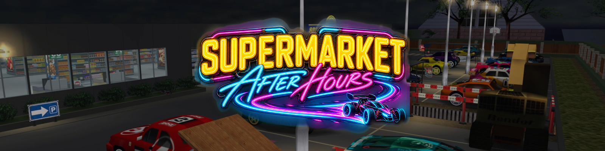
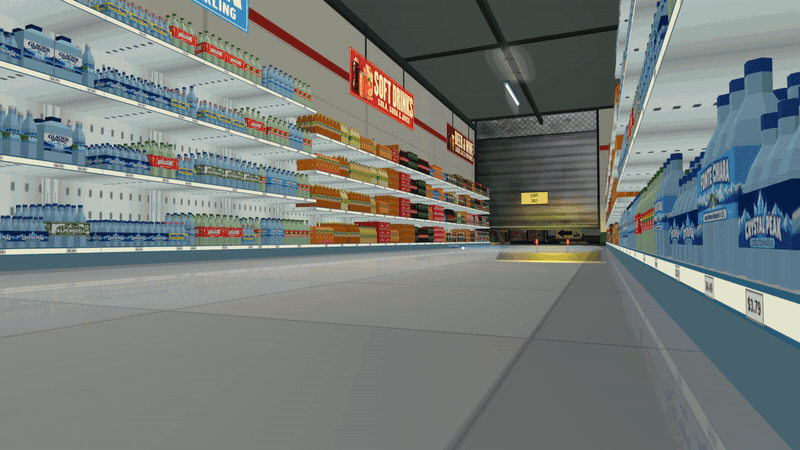
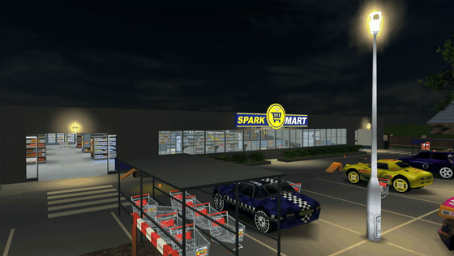
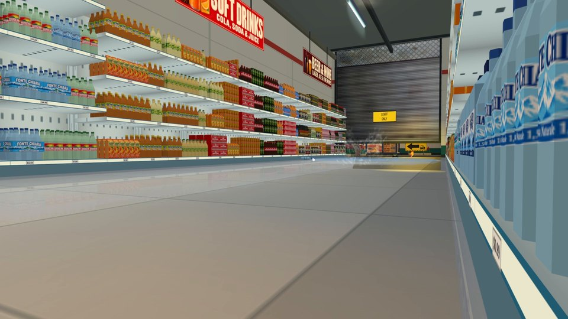
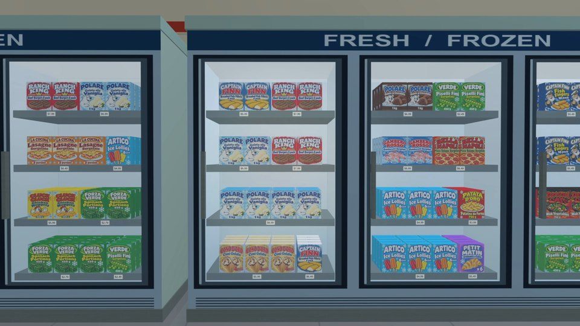
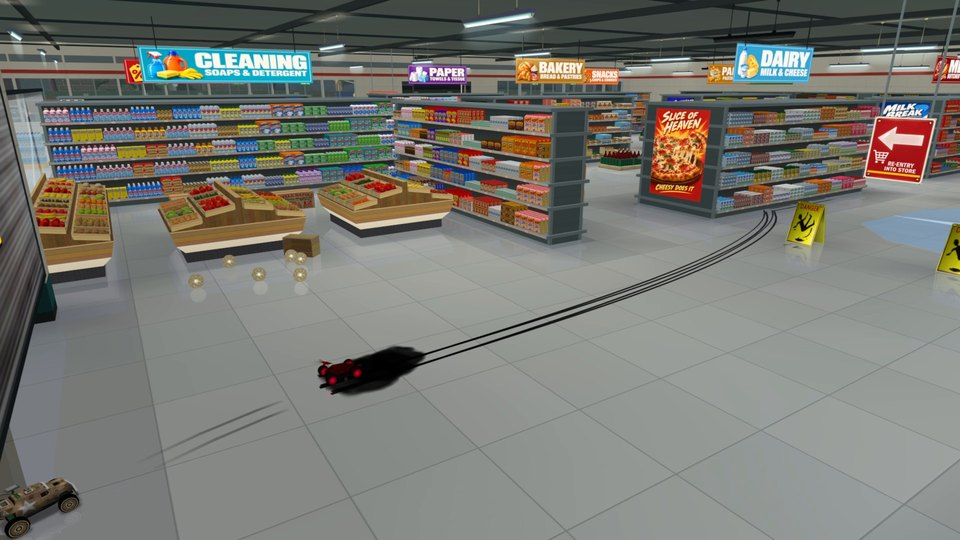
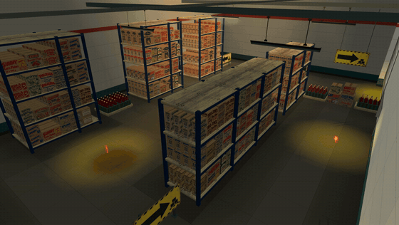
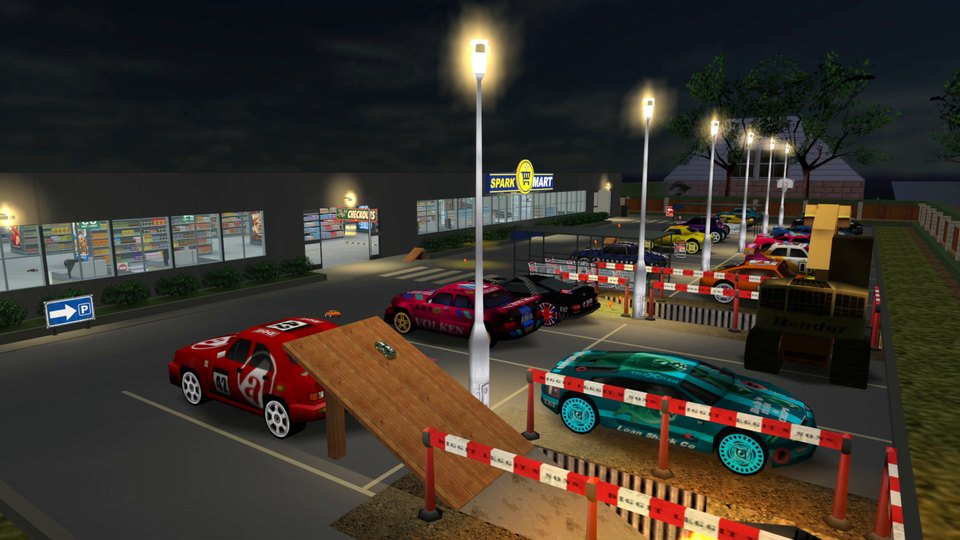

  
  
  
  

<b>The supermarket has closed for the night and the lights are low.</b> 
A track for RVGL: the shop aisles, the frozen food corridor, the car park and the warehouse, raced both ways.

  <a href="#-download"><b>Download</b></a> ·
  <a href="#-the-track"><b>The track</b></a> ·
  <a href="#-a-tour-of-the-shop"><b>Tour</b></a> ·
  <a href="#-versions"><b>Versions</b></a> ·
  <a href="#-reporting-a-problem"><b>Report</b></a> ·
  <a href="#-credits"><b>Credits</b></a>

## 🏁 The track

<table>
  <tr>
    <td align="center" width="25%"><h3>500 m</h3>as shown in game</td>
    <td align="center" width="25%"><h3>Normal</h3>difficulty</td>
    <td align="center" width="25%"><h3>0:33.500</h3>Time Trial challenge</td>
    <td align="center" width="25%"><h3>Reverse</h3>the lap the other way round</td>
  </tr>
</table>

The lap starts on the checkout straight and runs west, through the shelf aisles and the frozen food corridor, out of the automatic door into the car park. There it drops into the roadworks, runs through the underpass, climbs the planks and jumps a parked car, then comes back along the outside road and in through the second door. The last part crosses the east corridor, the dark warehouse under its flickering tube, the storage loop and the loading escalator down to the finish.

What to expect in a race:

- automatic sliding doors and strip curtains that swing when you drive through;
- a moving escalator and moving checkout belts that push the cars;
- wet floor at the frozen food spill and at a leaking bottle, with less grip;
- basketballs thrown across the car park once per race (not in Time Trial);
- seventeen parked cars with full collision, a plank ramp onto a car roof and steel ramps over two checkouts;
- three stars, pickups along the whole lap, direction signs at every turn;
- ambient sounds of the shop, the warehouse and the neighbourhood.

## 🎬 A tour of the shop

<table>
  <tr>
    <td width="50%"></td>
    <td width="50%"><h3>Spark Mart, after hours</h3>Outside, the car park under the lamp posts, the trolley shelters and seventeen parked cars, two of them from the Dreamcast version.</td>
  </tr>
  <tr>
    <td width="50%"><h3>244 products on the shelves</h3>Each with its own label and packaging shape, five shelf levels, up to four rows deep, a price tag under every facing.</td>
    <td width="50%"></td>
  </tr>
  <tr>
    <td width="50%"></td>
    <td width="50%"><h3>Lit freezers</h3>Frozen food and fresh dairy and meat on four shelves behind the glass of every door.</td>
  </tr>
  <tr>
    <td width="50%"><h3>Fruit, vegetables and a spill</h3>Tiers of wooden crates with 16 kinds of 3D produce, and a tipped-over crate of melons the cars can push around.</td>
    <td width="50%"></td>
  </tr>
  <tr>
    <td width="50%"></td>
    <td width="50%"><h3>The warehouse and the underpass</h3>Racks of 2,703 cartons under a flickering tube, then the roadworks and the round underpass lit by four pulsing lamps.</td>
  </tr>
  <tr>
    <td width="50%"><h3>Jump the parked car</h3>Up the planks, over a car roof and back onto the outside road; in reverse, the other way round.</td>
    <td width="50%"></td>
  </tr>
</table>

Trailers: [version 2.0](https://youtu.be/_eAWIeinl9Y) · [version 1.0](https://www.youtube.com/watch?v=bxL0ikQq64Y)

## 📦 Download

Grab `SuperMarket_After_Hours_<version>.zip` from the [latest release](https://github.com/6up3r/rvgl-supermarket-after-hours/releases/latest): the same file as on [Re-Volt World](https://www.revoltworld.net/dl/supermarket-after-hours/).

Extract the archive into your RVGL folder so that the `levels` and `gfx` folders merge with the existing ones. The track appears in the track list as **SuperMarket After Hours**; the reverse version is in the same entry. The readme inside the archive, in `levels/sm_afterhours/`, carries the full changelog and credits.

> [!TIP]
> Slow PC? Turn **Instances** off in the render settings: the game stops drawing the goods behind the front row of every shelf, while the shelves still look full from the aisle and every solid object keeps its collision. In multiplayer RVGL keeps Instances on for everyone.

## 🗂️ Versions

Every release published on Re-Volt World is here, the latest first. Each release carries its changes.

| Version | Released | What changed |
| --- | --- | --- |
| [2.1](https://github.com/6up3r/rvgl-supermarket-after-hours/releases/tag/v2.1) | 24 October 2026 | lighter on every PC, and a reverse version |
| [2.0.1](https://github.com/6up3r/rvgl-supermarket-after-hours/releases/tag/v2.0.1) | 12 October 2026 | lighter with Instances off, solid objects keep their collision |
| [2.0](https://github.com/6up3r/rvgl-supermarket-after-hours/releases/tag/v2.0) | 8 October 2026 | the whole shop restocked, a faster and cleaner AI |
| [1.0.3](https://github.com/6up3r/rvgl-supermarket-after-hours/releases/tag/v1.0.3) | 17 September 2026 | fixes from the players' comments |
| [1.0.2](https://github.com/6up3r/rvgl-supermarket-after-hours/releases/tag/v1.0.2) | 15 September 2026 | fixes from the second Re-Volt World review |
| [1.0.1](https://github.com/6up3r/rvgl-supermarket-after-hours/releases/tag/v1.0.1) | 15 September 2026 | fixes from the first Re-Volt World review |
| [1.0](https://github.com/6up3r/rvgl-supermarket-after-hours/releases/tag/v1.0) | 14 September 2026 | first release |

## 🛠️ Reporting a problem

Something looks, drives or sounds wrong? Open the [track report form](https://github.com/6up3r/rvgl-supermarket-after-hours/issues/new?template=track.yml): one report per problem, with the spot on the lap and a screenshot where it shows. The author reads every report; the fix comes in a later release.

## 🙏 Credits

- **Acclaim Studios London, Re-Volt (1999):** textures, models and sounds of the original game, from SuperMarket 1, Museum 1, Toys in the Hood 1, Botanical Garden, Toy World 1 and the night sky of Toytanic 2. Some are reworked for this track.
- **RVGL Dreamcast pack:** the LA 54 and the Groovster parked in the car park.
- **Re-Volt World staff:** EstebanMz reviewed versions 1.0 and 1.0.1, with screenshots and the fix for each problem.
- **Re-Volt World players:** Ced! and Drybones, whose reports were fixed in 1.0.3.
- **Tools:** Blender 2.79b with Marv's Re-Volt add-on (Marvin Thiel, GPL-3.0), Python, Pillow, NumPy.

<b>Use of AI tools</b>

 

- The fifteen posters were made with GPT (OpenAI gpt-image) on the author's own ideas and directions, then chosen, laid out and placed in the shop.
- The product box fronts and the English shop signs and banners started from images made with OpenAI's image generation built into Codex, then trimmed, cleaned and fitted to their boards by the author.
- From version 2.0 the 244 product labels, the bottle bands, the 29 brand cartons of the warehouse, the fruit and vegetable skins and the drinks aisle signs were made with GPT (OpenAI) on the author's directions, then cleaned, laid out and fitted to their 3D packs by the author.
- The water and drinks aisle started from a Codex (OpenAI) delivery of models and texture pages, reworked by the author.

 
Made by <b>6Up3r</b> · also by the author: <a href="https://github.com/6up3r/rvgl-museum-after-hours">Museum After Hours</a> · <a href="https://github.com/6up3r/rvgl-car-importer-releases">RVGL Car Importer</a>

